# Fixes after registration closes

Source: process document added 3 Oct 2026.

After registration is closed, the event organizers:

- make fixes
- move or copy entries
- align with the coaches
- ideally clear every category that has only one entry
- take the last-minute changes

## Edit or delete entries

In the Main Tree Menu, right-click "Individual / Team Entries". The menu has "Edit / Delete entries", "Search for competitor / delete", "Delete" and "Move entries".

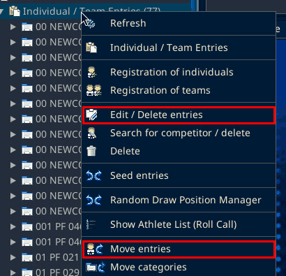

"Edit / Delete entries" opens the "Entries" window. Pick the category in the "Category" dropdown, then select the athlete row.

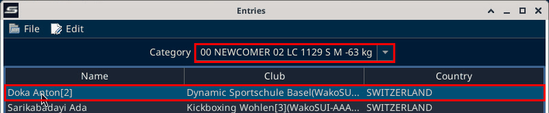

The buttons at the bottom are "Edit", "Refresh" and "Delete".

Delete on this window does not remove the entry. See [Remove an athlete from a category](fixes.md?id=remove-an-athlete-from-a-category).

## Remove an athlete from a category

Confirmed on SET 12.2.0 build 3 (live, 27 Nov 2026).

To take an athlete out of a category, set the entry status to Deleted under All entries. The Delete buttons on the Entries window do not remove the entry.

### Delete is blocked

In the Main Tree Menu, right-click "Individual / Team Entries" and choose "Edit / Delete entries" or "Search for competitor / delete".

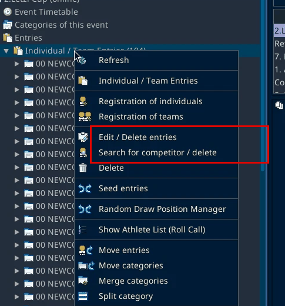

On "Edit / Delete entries", pick the category, select the athlete row, and click "Delete". SET asks "Attention! Do you really want to delete this entry?".

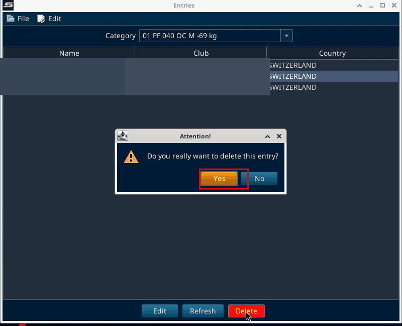

After Yes, a second Attention box says "Data still needed for event: '<event>: <athlete>'!". Click OK. The athlete stays in the list. Refresh still shows them.

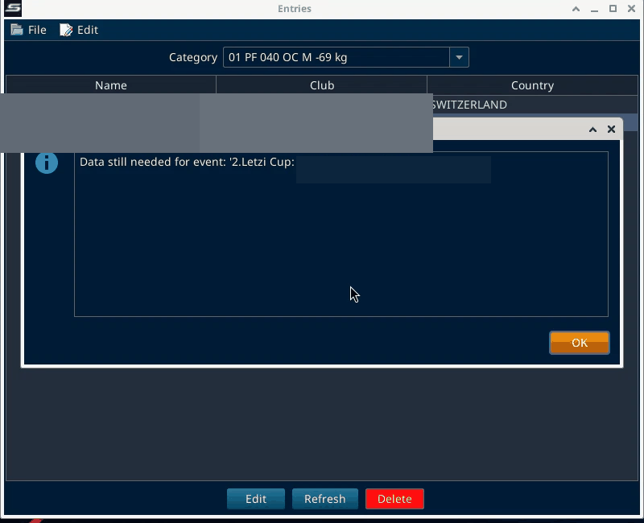

"Search for competitor / delete" ends the same way. Click "Search for competitor", filter by name, double-click the athlete, select the category, click Delete, then Yes. The same "Data still needed" notice appears, and the athlete stays.

This happened for two athletes on the live event. The cause is not confirmed.

Do not use "Delete" in the same right-click menu to remove one athlete. That opens the "Delete entry" window, which deletes by category, not by athlete. The search field does not filter the list to one athlete. See [Final fixes](final-fixes.md?id=move-or-remove-athletes).

### Set the status to Deleted

1. Open "Overviews / Statistics", then "All entries" (Ctrl+9).

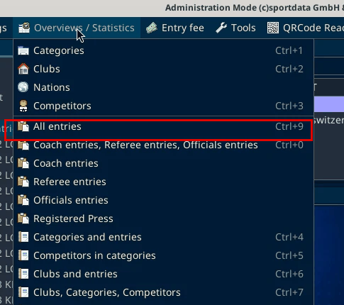

2. The "Athlete Entries" window opens. Type the name in the first filter box and press Enter. Select the athlete's row or rows.

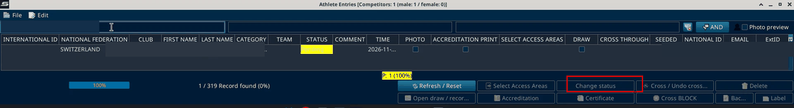

3. Click "Change status". The dialog title is "Change status:". It says "Please select the status for all selected entries".

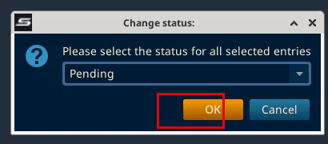

4. Open the list and pick "Deleted". The options are Pending, Approved, Deleted, Rejected, Weighed, Medical Test and Accreditation.

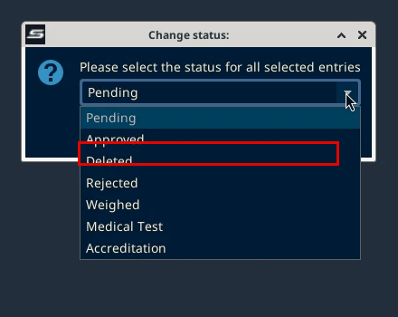

5. Click OK. The Status cell turns red and shows "Deleted". Refresh and Reset keep it. The footer counter shows "D:".

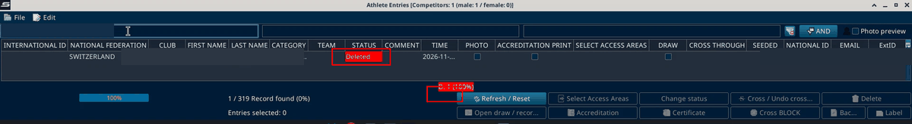

### After you set the status

It is not yet confirmed whether a Deleted athlete still appears in the category list or on the draw. Until that is checked, cross them through on the draw so no fight takes place. See [Cross through an athlete](final-fixes.md?id=cross-through-an-athlete).

## Move or copy entries

"Move entries" opens the "Move entries" window. Pick the source category under "Take from:".

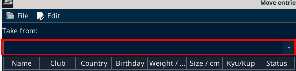

Pick the target category under "Move to:". Tick "Copy entries (keep entries in old category)" to keep the athletes in the old category as well.

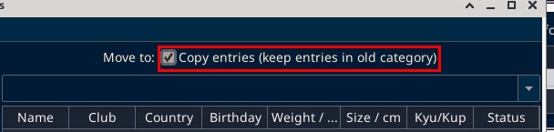

Select the athletes and click "Move". The full steps are on [Extra match](extra-match.md?id=b-copy-the-two-athletes).

## Find categories with only one entry

Open "Overviews / Statistics", then "Categories and entries" (Ctrl+4).

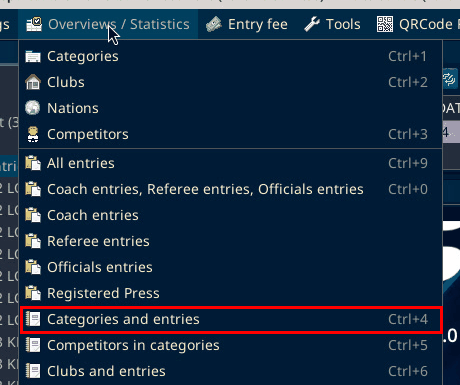

The window has the columns Category, Entries, Clubs and Nations. Click the "Entries" header to sort. Categories with one entry come to the top. SET sorts this column as text, so 10 can appear before 2.

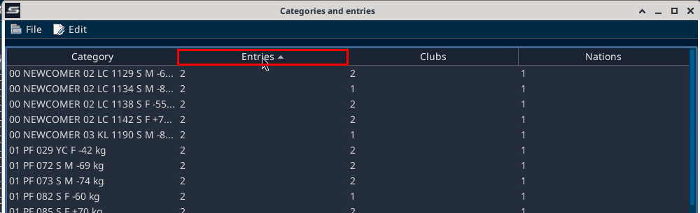

On SET 12.2.0 build 3 (local test, 6 Oct 2026): the lowest count on the local copy was 2, so no category had only one entry.

"Competitors in categories" (Ctrl+5) in the same menu shows one category at a time. Pick it in the "Category" dropdown.

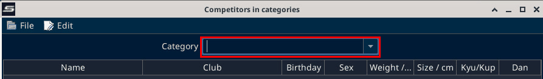
